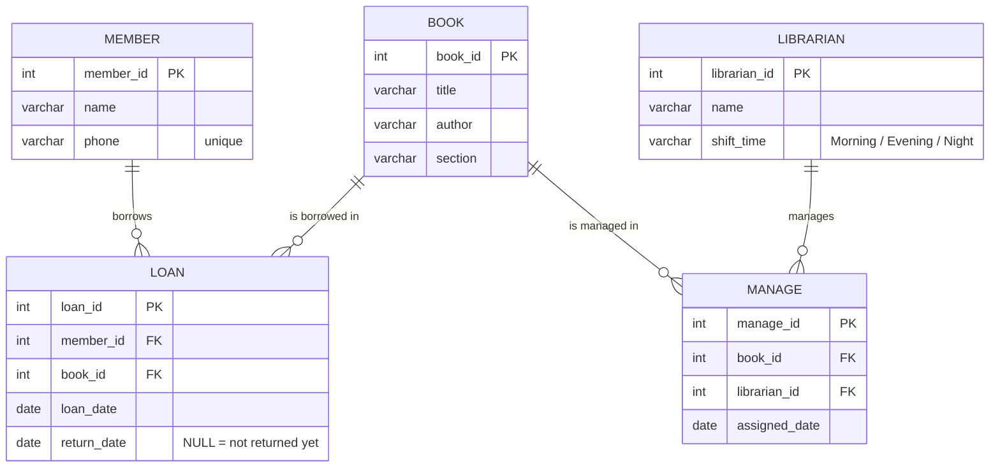
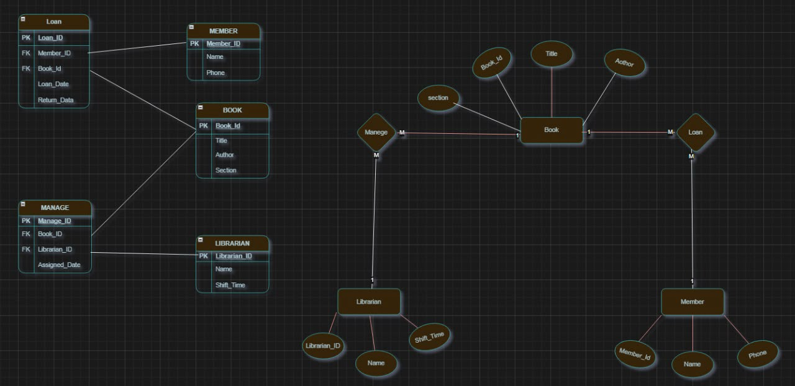

# Library Database (SQL)

A relational database for a small library. It stores members, books, librarians,
book loans, and which librarian manages which book. It includes sample data,
10 SQL queries, and one view.

Built with **PostgreSQL**.

## Database design (ERD)



- **LOAN** links members and books. One member can have many loans, and one book can be borrowed many times.
- **MANAGE** links librarians and books. It records which librarian is assigned to which book, and when.

### Original design

Before writing any SQL, I designed the database in [draw.io](https://www.drawio.com/):
the relational schema (left) and the ER diagram (right).



### Rules enforced by the database

| Rule | How |
|---|---|
| Every loan must point to a real member and a real book | Foreign keys |
| A book cannot be returned before it was borrowed | `CHECK (return_date IS NULL OR return_date >= loan_date)` |
| Shift must be Morning, Evening, or Night | `CHECK (shift_time IN (...))` |
| Two members cannot share a phone number | `UNIQUE (phone)` |
| Assignment dates cannot be before 2020 | `CHECK (assigned_date >= '2020-01-01')` |

### Testing the rules

[`sql/05_constraint_tests.sql`](sql/05_constraint_tests.sql) has 5 INSERT statements that break
the rules on purpose (duplicate phone, invalid shift, assignment date before 2020, return before loan,
member that does not exist). Every one is rejected by the database with an error, which proves the
rules work. I wrote tests 1 to 3 while building the project; tests 4 and 5 were added in 2026.

## Queries

All queries are in [`sql/03_queries.sql`](sql/03_queries.sql).

| # | Question | SQL used |
|---|---|---|
| Q1 | Which books are in the IT section? | `WHERE` |
| Q2 | Which books are not in the Programming section? | `WHERE <>` |
| Q3 | How many books does the library have? | `COUNT` |
| Q4 | How many loans does each member have? | `GROUP BY` |
| Q5 | Who made the earliest loan? | Subquery with `MIN` |
| Q6 | Which member borrowed which book, and when? | `JOIN` of 3 tables |
| Q7 | Which books did member 1023 borrow? | `JOIN` + `WHERE` |
| Q8 | Which books are still out? | `IS NULL` |
| Q9 | How many days did each returned loan last? | Date arithmetic |
| Q10 | How many books does each librarian manage? | `LEFT JOIN` + `GROUP BY` |

The view `v_loan_report` in [`sql/04_views.sql`](sql/04_views.sql) saves the loan report
(member, book, loan date, return date) so it can be queried like a table.

### Example result (Q8: books still out)

| title | member_name | loan_date |
|---|---|---|
| Clean Code | Sara Omar | 2025-11-03 |
| Introduction to Algorithms | Lama Hassan | 2025-11-06 |

## How to run

1. Install PostgreSQL and pgAdmin 4.
2. In pgAdmin, create a new database named `library`.
3. Open the Query Tool on that database and run the files in order:
   1. `sql/01_schema.sql` (creates the tables)
   2. `sql/02_sample_data.sql` (adds sample data)
   3. `sql/03_queries.sql` (runs the queries)
   4. `sql/04_views.sql` (creates the view)
   5. `sql/05_constraint_tests.sql` (optional: each test should fail with an error)

`01_schema.sql` drops and recreates the tables, so you can run everything again from the start.

## Project structure

```
library-database/
├── README.md
├── docs/
│   └── erd-original.jpeg
└── sql/
    ├── 01_schema.sql
    ├── 02_sample_data.sql
    ├── 03_queries.sql
    ├── 04_views.sql
    └── 05_constraint_tests.sql
```

## About this project

- University group project (4 students), 2025. I wrote the SQL.
- I used AI tools to help with some parts of the code, and I made sure I understood each part before using it.
- In 2026 I converted it to PostgreSQL, fixed a query that returned no rows (Q7 used a member ID that did not exist), and added Q8 to Q10.
- All names and phone numbers in the sample data are made up.
